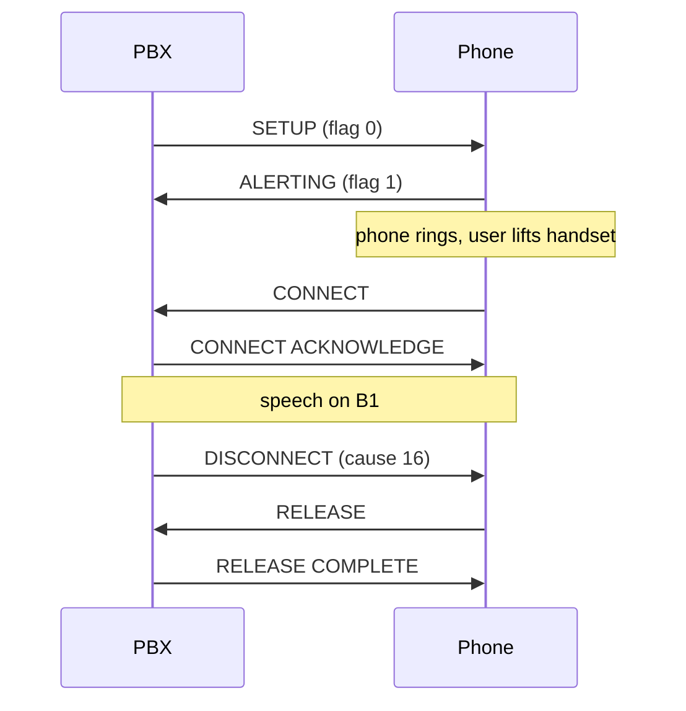
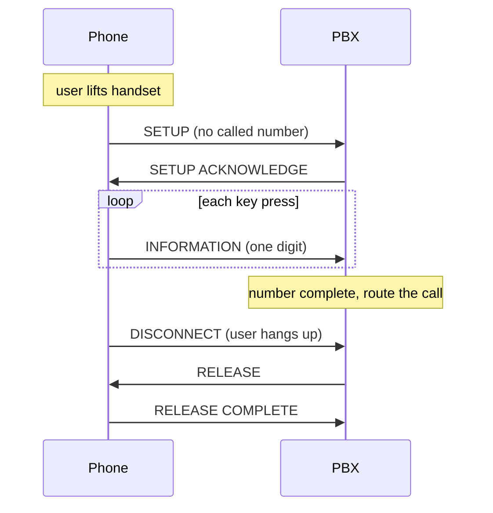

# Calls

Plain telephony needs only standard DSS1 plus the [registration](registration.md) reply. Bytes below are I-frame information fields (layer 3), TEI 64.

## Incoming call (network to phone)



SETUP can be sent as an I-frame or as a broadcast UI frame (SAPI 0, TEI 127); the phone accepts both. CONFIRMED.

```
08 01 01 05                       SETUP, call reference 1, flag 0
04 03 80 90 a3                    bearer capability: speech, A-law
18 01 81                          channel: B1 (preferred)
28 09 "Test call"                 display text (optional)
6c <len> 21 80 "0301234"          calling party number
70 <len> 81 "1"                   called party number
```

The phone answers `08 01 81 01` (ALERTING, flag 1) and, when the handset is lifted, `08 01 81 07` (CONNECT). The network sends `08 01 01 0f` (CONNECT ACKNOWLEDGE).

To clear from the network send DISCONNECT with a cause, flag 0:

```
08 01 01 45 08 02 80 90
```

The phone returns `RELEASE` (`08 01 81 4d`) or `RELEASE COMPLETE`. If the network sets the flag wrong (`81`), the phone answers RELEASE COMPLETE with cause 81 and the call is not cleared. CONFIRMED.

## Outgoing call (phone to network)



Lifting the handset sends SETUP with **no called party number**, so the network must support overlap sending. CONFIRMED:

```
08 01 01 05
04 03 80 90 a3        bearer capability: speech, A-law
18 01 83              channel: any
7d 02 91 81           high layer compatibility: telephony
7e 01 04              user-user
```

The network answers SETUP ACKNOWLEDGE with the call reference flag set:

```
08 01 81 0d 18 01 89  channel: B1 exclusive
```

Each key press then arrives as its own INFORMATION message with one digit, flag 0:

```
08 01 01 7b 70 02 81 31      digit "1"
08 01 01 7b 70 02 81 32      digit "2"
```

The digits appear on the phone's display as they are dialled. The phone does not send a "number complete" marker: **the network must decide when dialling is finished** (digit timeout, a known numbering plan, or `#`).

When the user hangs up the phone sends `08 01 01 45 08 02 80 90` (DISCONNECT); the network answers RELEASE and the phone sends RELEASE COMPLETE. CONFIRMED.

## After dialling (not yet tested)

From the phone's call-state tables (INFERRED): in the overlap-sending state it accepts ALERTING (moving to "call delivered"), CALL PROCEEDING (moving to "outgoing proceeding") and CONNECT (moving to "active"; it answers with CONNECT ACKNOWLEDGE). So the network should answer a completed number with CALL PROCEEDING and then ALERTING and CONNECT as the far end progresses. The B-channel audio itself is not part of the D-channel and was not tested.
