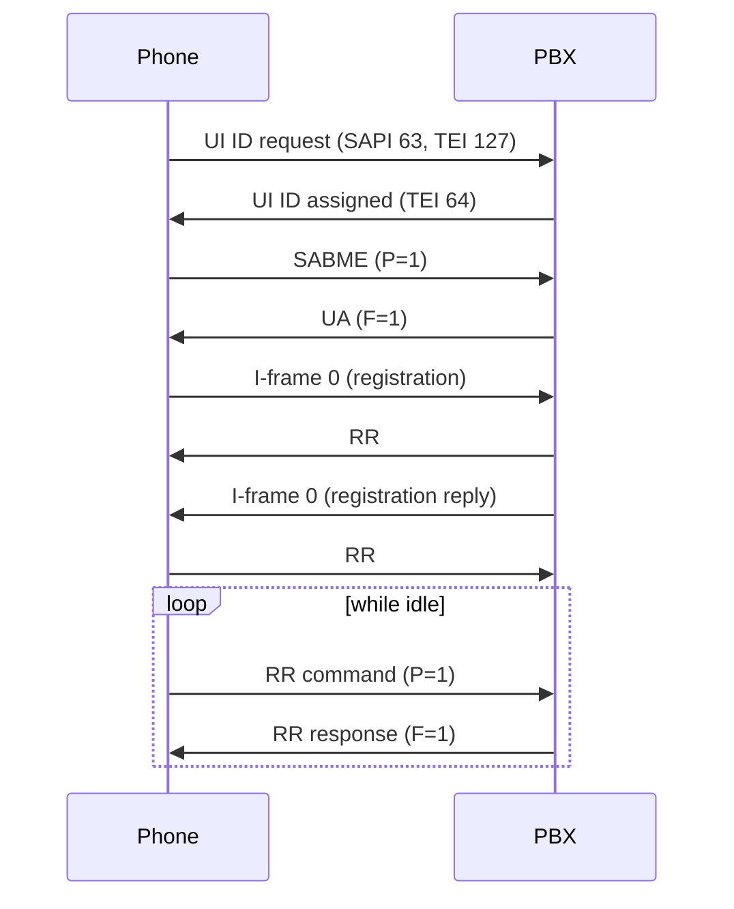

# Link layer (Q.921)

The phone is a standard ISDN terminal on a basic-rate S0 bus. The PBX is the network side (NT). Layer 1 activation follows the normal ISDN procedure.

## Addressing

An address field has two octets: `SAPI<<2 | C/R<<1 | EA=0`, then `TEI<<1 | EA=1`.

| Direction | Command | Response |
|---|---|---|
| Network to phone | C/R = 1 (first octet `02`) | C/R = 0 (`00`) |
| Phone to network | C/R = 0 (`00`) | C/R = 1 (`02`) |

- Signalling uses **SAPI 0**. TEI management uses SAPI 63 / TEI 127.
- The phone drops frames with the wrong C/R bit, so a PBX that sends commands with C/R = 0 is not heard. CONFIRMED.
- Frames for other SAPIs, and point-to-point UI frames, are ignored by the phone. CONFIRMED (code reading).

## TEI assignment

The phone assigns itself a TEI automatically about 82 million emulated cycles after power-up, with an ID request (`Ri` is a random 16-bit reference):

```
phone -> network   fc ff 03 0f Ri Ri 01 ff        UI, SAPI 63, TEI 127: ID request, Ai = 127
network -> phone   fe ff 03 0f Ri Ri 02 <tei>     ID assigned, <tei> = (TEI << 1) | 1
```

The phone accepts TEIs 64 to 126. CONFIRMED. The author's stack assigns 64.

## Establishing the link

The phone then sends `SABME` with P = 1 (`00 81 7f` for TEI 64). The network answers `UA` with F = 1 (`00 81 73`). CONFIRMED.

- Only modulo-128 operation exists: the phone knows SABME and has no SABM handling. CONFIRMED (code reading).
- The window size is 1: the phone sends one I-frame and waits for the acknowledgement. The network should do the same.
- I-frames from the network are accepted only as commands (C/R = 1). Otherwise the phone sends SABME to re-establish. CONFIRMED (code reading).
- Maximum control plus information length 260 octets; longer frames are discarded.

## Keep-alive polling

When the link is idle the phone sends `RR` commands with P = 1 (for example `00 81 01 03`: N(R) = 1, P = 1) at regular intervals. **The network must answer each poll with an `RR` response with F = 1.**

After four unanswered polls the phone gives up, sends `SABME` again and repeats its registration (see [Registration](registration.md)). CONFIRMED in emulation.



## Acknowledgements

- Acknowledge every I-frame with `RR`, setting F to the received P bit. Use `REJ` on a sequence error.
- An I-frame is acknowledged by the other side's N(R). With window 1, wait for N(R) = N(S) + 1 before sending the next.
- Retransmit an unacknowledged I-frame after a timeout. The phone's own timers are table values of 20, 40 and 200 (units unknown, UNKNOWN), with N200 = 3 retransmissions.
