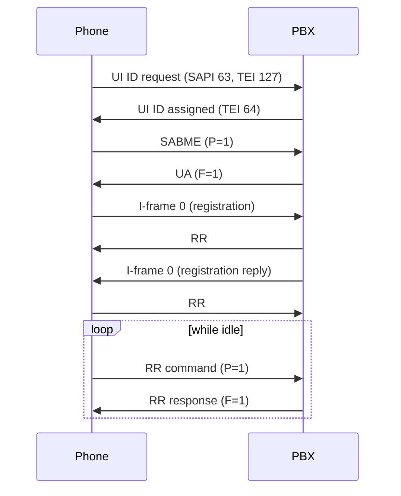

# Link layer (Q.921)

!!! info "Evidence tags"
    ✅ tested in emulation · 📖 read from code or tables, not exercised · 🔶 inferred · ❓ unknown · 🔌 hardware-verified (nothing yet). See the [overview](index.md#evidence-tags).

The phone is a standard ISDN terminal on a basic-rate S0 bus. The PBX is the network side (NT). Layer 1 activation follows the normal ISDN procedure.

## Layer 1 activation (PBX-observed)

On a point-to-point S0 line in emulation, the network side requests activation as soon as it starts (it keeps sending INFO 2). The phone powers up, reports the activation request to its own firmware, answers with its activation request (INFO 3), and the line is active: the network side then sees "activated" and the phone sees the activated indication (INFO 4). Layer 2 only starts after that: the first frame from the network is an unacknowledged broadcast (see [Codeset 7](codeset7.md#broadcasts-pbx-observed)), then the phone's TEI request. ✅ Tested, PBX-observed.

## Addressing

An address field has two octets: `SAPI<<2 | C/R<<1 | EA=0`, then `TEI<<1 | EA=1`.

| Direction | Command | Response |
|---|---|---|
| Network to phone | C/R = 1 (first octet `02`) | C/R = 0 (`00`) |
| Phone to network | C/R = 0 (`00`) | C/R = 1 (`02`) |

- Signalling uses **SAPI 0**. TEI management uses SAPI 63 / TEI 127.
- The phone drops frames with the wrong C/R bit, so a PBX that sends commands with C/R = 0 is not heard. ✅ Tested.
- Frames for other SAPIs, and point-to-point UI frames, are ignored by the phone. 📖 Read.

## TEI assignment

The phone assigns itself a TEI automatically about 82 million emulated cycles after power-up, with an ID request (`Ri` is a random 16-bit reference):

```
phone -> network   fc ff 03 0f Ri Ri 01 ff        UI, SAPI 63, TEI 127: ID request, Ai = 127
network -> phone   fe ff 03 0f Ri Ri 02 <tei>     ID assigned, <tei> = (TEI << 1) | 1
```

The phone accepts TEIs 64 to 126. ✅ Tested. The author's stack assigns 64.

## Establishing the link

The phone then sends `SABME` with P = 1 (`00 81 7f` for TEI 64). The network answers `UA` with F = 1 (`00 81 73`). ✅ Tested.

- Only modulo-128 operation exists: the phone knows SABME and has no SABM handling. 📖 Read.
- The window size is 1: the phone sends one I-frame and waits for the acknowledgement. The network should do the same. 📖 Read.
- I-frames from the network are accepted only as commands (C/R = 1). Otherwise the phone sends SABME to re-establish. 📖 Read.
- Maximum control plus information length 260 octets; longer frames are discarded. 📖 Read.

## Keep-alive polling

When the link is idle the phone sends `RR` commands with P = 1 (for example `00 81 01 03`: N(R) = 1, P = 1) at regular intervals. **The network must answer each poll with an `RR` response with F = 1.**

After four unanswered polls (the count is 📖 Read; the re-establishment was ✅ seen) the phone gives up, sends `SABME` again and repeats its registration (see [Registration](registration.md)). ✅ Tested.



## Acknowledgements

- Acknowledge every I-frame with `RR`, setting F to the received P bit. Use `REJ` on a sequence error.
- An I-frame is acknowledged by the other side's N(R). With window 1, wait for N(R) = N(S) + 1 before sending the next.
- Retransmit an unacknowledged I-frame after a timeout. The phone's own timers are table values of 20, 40 and 200 (units ❓ Unknown), with N200 = 3 retransmissions.
