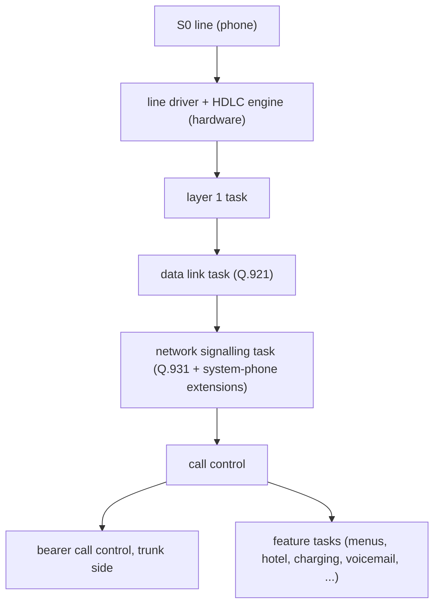

# The PBX side (ICT88)

!!! info "Evidence tags"
    ✅ tested in emulation · 📖 read from code or tables, not exercised · 🔶 inferred · ❓ unknown · 🔌 hardware-verified (nothing yet). See the [overview](../index.md#evidence-tags).

The system phone talks to an ICT-series PBX. This part of the notes describes the **PBX**: what it is made of, how it serves a phone, and how its behaviour was observed. The goal is to know enough to replace it with a PC and an ISDN card, and later to understand the hardware well enough to run other software on it.

!!! note "Scope"
    Hardware facts and observable behaviour, in the author's own words. No firmware, no listings, no internal names or addresses of the PBX software, no vendor documentation.

## Pages

| Page | Content |
|---|---|
| [Hardware](hardware.md) | CPU, memory, the S0 line interfaces, the HDLC engine, Ethernet, USB, what is still unknown |
| [Serving a system phone](phone-service.md) | What the PBX sends and answers on the S0 line: layer 1, broadcasts, registration policy, call handling |
| [Call processing](call-processing.md) | How a call travels through the PBX's software layers |
| [Emulation and method](emulation.md) | How all this was observed: the S0 link between the emulated phone and the emulated PBX, and its limits |

## Overview

The PBX is a small ISDN exchange. Inside it is an ARM-class processor with a real-time operating system that runs about forty cooperating tasks. They talk to each other only through messages sent via one central router, in layers that follow the ISDN model:

📖 The picture is read from the PBX software's structure and confirmed by watching its internal messages in emulation (see [Call processing](call-processing.md)). Besides the integrated S0 lines the PBX has optional modules for analog extensions, DECT handsets and an IP router; those are separate protocols and are not covered yet.
