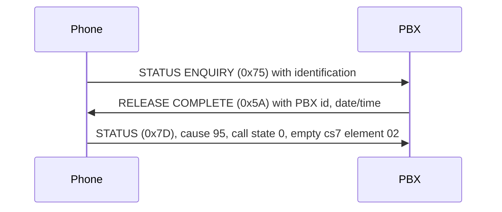

# Registration

!!! info "Evidence tags"
    ✅ tested in emulation · 📖 read from code or tables, not exercised · 🔶 inferred · ❓ unknown · 🔌 hardware-verified (nothing yet). See the [overview](index.md#evidence-tags).

After the data link comes up, and again after **every** link re-establishment, the phone identifies itself. Until the PBX replies, the phone repeats the message periodically.



## Phone to PBX

Message type `75` (the standard STATUS ENQUIRY value, used here for identification), call reference `01`, flag 0. ✅ Tested:

```
08 01 01 75
97
01 08 50 53 31 33 30 33 35 37                       element 01: "PS130357"
0f 37 ff ff 00 00                                     further elements, not decoded
06 "V5.250"                                           length 6, firmware version string
11 "12/08/15 15:04:01"                                 length 17, build date string
01 ff
12 ff ff ff ff ff ff ff ff ff ff ff
```

- The first message is the long form above. Retries carry only `97 01 08 "PS130357"`.
- `PS130357` identifies the terminal class. The PBX distinguishes classes by this string; other strings seen in the PBX tables are `US050561`, `UR230560`, `DTDECT01` and `DTAG0104` (other terminal types). 📖 Read from the PBX's tables, 🔶 meaning inferred.
- The octets `06` and `11` in front of the version and date strings are their lengths (6 and 17 characters). The element ids that go with them, and the other octets (`0f 37 ff ff 00 00`, `01 ff`, `12 ff ...`), are ❓ Unknown.

## PBX to phone

A RELEASE COMPLETE using the phone's call reference with the flag set:

```
08 01 81 5a
08 02 85 d1                       cause 81, location 5 (optional in effect)
29 05 yy mm dd hh mi              date and time, binary (optional)
97
01 08 44 57 31 33 30 39 35 38     element 01: "DW130958", the PBX identification
26 02 82 80                       constant (optional in effect)
```

✅ Tested:

- the phone stops repeating, sets its clock from the date/time element and adds a *Tel. drctry* entry to its idle menu;
- the reply must be type `5a`, must carry the call reference flag, and must contain codeset 7 element `01`;
- a header-only reply, a reply with the flag clear, or another message type (`7d` was tried) is ignored and the phone keeps repeating;
- the cause location (`85` or `81`) and element `26` make no visible difference; the date/time element is optional.

## Long and short form (PBX-observed)

The original PBX treats the two forms of the phone's message differently:

- the **short** form (`97 01 08 "PS130357"` only) gets the full reply above;
- the **long** form (with version and date strings) gets only a bare RELEASE COMPLETE with cause 81 and no codeset 7 content, `08 01 81 5a 08 02 85 d1`, after which the phone retries (in the emulation the second attempt was again the long form, the third the short form).

The phone accepts the full reply to either form (✅ Tested with the test PBX), so an implementation may answer both with the full reply; the original behaviour is the two-step one. ✅ Tested, PBX-observed. The PBX's full reply was byte-identical to the one shown above (date and time were zero because the PBX clock was not set).

## The STATUS that follows

A short time after any accepted reply the phone sends

```
08 01 01 7d | 08 02 80 df | 14 01 00 | 97 02 00
```

a STATUS for call reference 1 with cause 95, call state 0 (null) and an **empty** codeset 7 element `02`. It is sent regardless of what the reply contained, and the tests needed no answer to it. Meaning of the empty element: ❓ Unknown (it is the system-phone data container, see [Codeset 7](codeset7.md)).

## Re-registration

If the PBX stops answering polls the phone re-establishes the link and registers again, with the next call reference (`02`, then `03`, ...). The PBX must reply to each.
